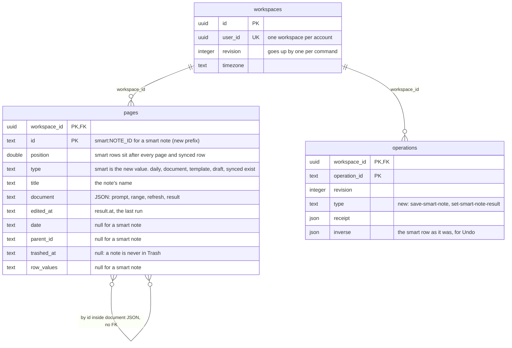
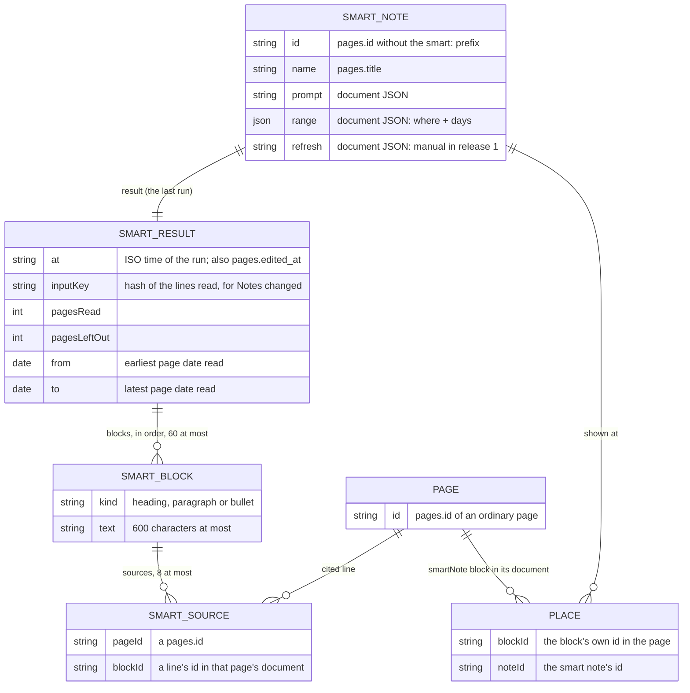

# Smart note (first release) Implementation Plan

> **For agentic workers:** REQUIRED SUB-SKILL: Use superpowers:subagent-driven-development (recommended) or superpowers:executing-plans to implement this plan task-by-task. Steps use checkbox (`- [ ]`) syntax for tracking.

**Goal:** A read-only block on a page whose text the model writes from a saved prompt and a range of the workspace, with sources, refreshed on demand.

**Architecture:** A smart note is a workspace-level record (`Workspace.smartNotes`), stored as a hidden page row the way a synced block's record is, so no table or column is added. A page's document holds only a `smartNote` block with the note's id; the result is never expanded into the page, so nothing derived from pages sees it. The server only computes a result (range collection in the domain, one structured model call); the tab stores it through its own command queue, as the day draft does.

**Tech Stack:** TypeScript, TanStack Start server functions, zod, BlockNote 0.56 custom block (`createReactBlockSpec`), OpenRouter through `src/server/model/openrouter.ts`, `node --test` with PGlite.

**Spec:** `docs/design/smart-note.md` (release 1 is §10 step 1; decisions in §11).

## Global Constraints

- English only in code, comments, identifiers and commit messages. No model identifier in any commit or file.
- Release 1 has no schedule: every stored note has `refresh: 'manual'` and setup shows no Refresh field.
- The result never enters a page document. Search, tags, events, to-dos, "Linked from", the day draft and other smart notes must not see it.
- No model, or AI off for the account: the last result still shows; no Refresh, no Edit, and `/` does not offer Smart note. Nothing mocked is ever shown as a model's answer.
- The model key stays on the server. Logs carry counts, timings and cost only, never the user's words.
- On-screen copy, exactly: `Smart note`, `New smart note`, `Run preview`, `Save`, `Cancel`, `Notes changed`, `Updated {relative time}`, `Couldn't refresh · Retry`, `Its range was deleted`, `No notes in this range`, `This smart note was deleted`, `Read {n} pages · {from} to {to}`, ` · {m} older pages left out`, menu items `Edit`, `Copy`, `Turn into text`, `Delete`. No explanatory text anywhere (quiet copy).
- Colours from existing tokens in `src/styles.css` only. `Notes changed` uses `--warn` on `--warn-soft`. Source numbers use the token the editor's line-link chips use. No new colour.
- 44 px touch targets at 390. The block takes no caret (`contentEditable={false}`, events stopped as `ButtonLine` does), so it is IME-safe.
- Every visual change passes `node scripts/check-alignment.mjs <url>` with 0 FAIL / 0 MISSING at 1280 and 390 on a copy of real data before it is shown.
- Limits, in one exported constant `smartLimits`: `name: 120`, `prompt: 2000`, `pages: 50`, `tag: 100`, `notes: 100`, `blocks: 60`, `text: 600`, `sourcesPerBlock: 8`, `inputChars: 60_000`, `pageChars: 6_000`, `lineChars: 400`.

## Review Focus

1. The model cites a line id that was not sent, returns empty text, or returns more than 60 blocks: the id is dropped, the empty block is dropped, the list is cut at 60. (Task 4)
2. A block whose record is missing (Undo of the save, a paste from another workspace) or whose page is in Trash: the block says `This smart note was deleted`, nothing throws, and the note is not listed in the picker. (Tasks 1, 5)
3. Chinese text and emoji in notes and prompt: truncation at `lineChars` and `pageChars` never splits a surrogate pair. (Task 3)
4. A result arrives for a note that was removed meanwhile (another tab, Undo): `set-smart-note-result` is refused with `Smart note not found`, and the tab shows no error. (Tasks 1, 5)
5. A range far larger than the budget, or one page larger than the whole budget: the newest pages are read, one page cannot take more than `pageChars`, and `pagesLeftOut` is exact. (Task 3)

## File Structure

| File | Responsibility |
| --- | --- |
| `src/domain/smart-note.ts` (new) | Types, limits, places, range collection, input key, result as lines and as text |
| `src/domain/types.ts`, `command-schema.ts`, `workspace.ts` | The record on the workspace; two commands |
| `src/domain/editor-document.ts` | `textKey`, `describeLine` (moved from the day draft) |
| `src/server/workspace-rows.ts`, `src/domain/workspace-changes.ts` | The record as a hidden page row; the record in change replies |
| `src/server/model/access.ts` (new) | Which accounts have the model on |
| `src/server/model/smart-note.ts` (new) | Messages, answer schema, answer checking, one run |
| `src/server/functions.ts` | `smartNotesOn`, `askSmartNote` |
| `src/components/smart-note-block.tsx` (new) | The block, its body, refresh, states, menu |
| `src/components/smart-note-setup.tsx` (new) | Picker and setup in Buttons' shell, with preview |
| `src/components/page-editor.tsx`, `app-shell.tsx`, `icons.tsx`, `src/styles.css` | Block spec, `/` item, host, icon, styles |
| `src/domain/export.ts` | A smart note as static text |
| `tests/smart-note*.test.ts` (new) | Domain, storage, collection, server |

## Data model (ERD)

**No table, column, index or migration is added.** A smart note is one more row in `pages`, as a synced block's record already is. What changes is three values: a new `pages.type` (`smart`), a new `pages.id` prefix (`smart:`), and two new `operations.type` values.

### Tables touched (Postgres)

Columns are as they are today; the notes on the right say what a smart note puts in them.



The self-relation on `pages` is the two places a smart note is referred to, both by id inside JSON text and neither enforced by the database:

- a page's `document` holds a block `{ "type": "smartNote", "props": { "noteId": "<noteId>" } }` (a place);
- a smart row's `document` holds each source as `{ "pageId", "blockId" }` (a cited line).

The domain checks both: a block with no record shows `This smart note was deleted`, and a source whose page is gone is dropped on save.

### What the smart row holds



`SMART_NOTE` is the row; `SMART_RESULT`, `SMART_BLOCK` and `SMART_SOURCE` live inside its `document` JSON; `PLACE` lives inside another page's `document` JSON.

### Column by column

| `pages` column | A smart note's value |
| --- | --- |
| `workspace_id` | The owner's workspace, as every row |
| `id` | `smart:` + the note's id |
| `position` | After every page row and synced row |
| `type` | `smart` |
| `title` | The note's name |
| `document` | `{"prompt", "range", "refresh", "result"}` as JSON text |
| `edited_at` | `result.at` |
| `date`, `url`, `parent_id`, `trashed_at`, `trash_id`, `database_json`, `row_values`, `created_at`, `icon`, `cover`, `cover_position` | null |
| `handoff_done`, `review_saved` | false |

### Other stores and the wire

- **SQLite (local dev):** the one `workspace.data` JSON gains a `smartNotes` array. No change to the table.
- **Change replies to the browser:** `WorkspaceChanges.smartNotes` carries the whole list when it changed, as `synced` does.
- **Undo:** an operation's `inverse` already holds changed `pages` rows whole, so a smart row is restored like any other.

### Rollback

The `smartNote` block type raises the rollback floor, as Buttons and the database block did (`docs/design/buttons.md`, `docs/plan/b21-sizing.md`): those shipped in two steps, first a release with the block spec and nothing that makes one, which became the floor, then the feature. This branch holds both steps and lands as one release (Brian, 2026-11-13), not as two (the block spec and the `smart` row handling first, then the `/` item and setup). What that accepts: a tab still on the previous build cannot open a page holding the block until it reloads, and there is no release to roll back to that knows the block.

A build from before this change reads a `smart` row as an ordinary page with a JSON body, because `pages.type` is free text, and a save there rewrites its `document` as a page's. This build leaves a row that is not a note's shape out of the workspace and keeps the row as stored (no write removes or rewrites it): that note's content was lost to the older build's save, and the pages holding its block show `This smart note was deleted`. So rolling forward again is safe for the workspace, and not for a note saved over by the older build. To roll back for longer, first run, per workspace or for all: `delete from daythread.pages where type = 'smart'` (the notes are lost; the pages holding their blocks are untouched), after backing those rows up.

### Decided for release 2, not now

The scheduled tick will need to find due notes across workspaces. Whether that reads `document` JSON or gets a column or partial index on `pages (type) where type = 'smart'` is decided then, with real row counts.

---

### Task 1: The record and its two commands

**Files:**
- Create: `src/domain/smart-note.ts`
- Modify: `src/domain/types.ts` (`Page.type`, `Workspace`, `Action`), `src/domain/command-schema.ts`, `src/domain/workspace.ts` (`execute` switch)
- Test: `tests/smart-note.test.ts`

**Interfaces:**
- Produces, in `src/domain/smart-note.ts`:

```ts
export const smartNoteBlockType = 'smartNote'
export const smartLimits = { name: 120, prompt: 2000, pages: 50, tag: 100, notes: 100, blocks: 60, text: 600, sourcesPerBlock: 8, inputChars: 60_000, pageChars: 6_000, lineChars: 400 } as const
export type SmartWhere = { kind: 'workspace' } | { kind: 'pages'; pageIds: string[] } | { kind: 'tag'; tag: string } | { kind: 'days' }
/** 0: all time. */
export type SmartWindow = 0 | 7 | 30 | 90
export interface SmartRange { where: SmartWhere; days: SmartWindow }
export interface SmartSource { pageId: string; blockId: string }
export interface SmartBlock { kind: 'heading' | 'paragraph' | 'bullet'; text: string; sources: SmartSource[] }
export interface SmartResult { blocks: SmartBlock[]; at: string; inputKey: string; pagesRead: number; pagesLeftOut: number; from: LocalDate | null; to: LocalDate | null }
export interface SmartNote { id: string; name: string; prompt: string; range: SmartRange; refresh: 'manual' | 'daily' | 'hourly'; result: SmartResult }
export function smartNoteOf(ws: Pick<Workspace, 'smartNotes'>, id: string): SmartNote | undefined
/** Blocks showing the note on live pages (not in Trash). */
export function smartPlaces(ws: Pick<Workspace, 'pages'>, noteId: string): { page: Page; blockId: string }[]
/** For the picker: notes with at least one place, by name. */
export function placedSmartNotes(ws: Pick<Workspace, 'pages' | 'smartNotes'>): { note: SmartNote; places: number }[]
```

- Produces, in `types.ts`: `Page.type` gains `"smart"` (a stored row only, never in `ws.pages`); `Workspace.smartNotes?: SmartNote[]` (absent until there is one); actions `{ type: "save-smart-note"; note: SmartNote }` and `{ type: "set-smart-note-result"; noteId: string; result: SmartResult }`.
- Produces, in `command-schema.ts`: exported zod shapes `smartRange`, `smartResult`, `smartNote`, bounded by `smartLimits`, and the two actions in the `action` union.

- [ ] **Step 1: Write the failing tests** in `tests/smart-note.test.ts`, using `harness` and `para` from `tests/v2-helpers.ts`:

```ts
const result = (over: Partial<SmartResult> = {}): SmartResult => ({ blocks: [{ kind: 'bullet', text: 'Guest checkout is out', sources: [{ pageId: 'doc', blockId: 'l1' }] }], at: '2026-11-12T09:00:00.000Z', inputKey: 'k1', pagesRead: 1, pagesLeftOut: 0, from: '2026-11-12', to: '2026-11-12', ...over })
const note = (over: Partial<SmartNote> = {}): SmartNote => ({ id: 'n1', name: 'Checkout', prompt: 'What do my notes say about checkout?', range: { where: { kind: 'workspace' }, days: 0 }, refresh: 'manual', result: result(), ...over })
const block = (id: string, noteId: string): EditorNode => ({ id, type: 'smartNote', props: { noteId }, children: [] })

test('save-smart-note stores the note; saving the same id replaces it', () => { /* run twice with a changed name; ws.smartNotes has one entry with the new name; receipt.message === 'Smart note saved' */ })
test("a blank name is taken from the prompt's first sentence", () => { /* name: '   ' → 'What do my notes say about checkout?'; a long sentence is cut at a word with "…", at a character in Chinese (Brian 5e7596ac) */ })
test('a source whose page does not exist is dropped, not refused', () => { /* sources [{pageId:'gone',…},{pageId:'doc',…}] → one source */ })
test('refused: empty prompt; pages range with no page; a 101st note', () => { /* assert.throws with /prompt|page|limit/i */ })
test('set-smart-note-result replaces the result; an unknown note is refused', () => { /* 'Smart note updated'; assert.throws(/Smart note not found/) */ })
test('Undo of a save takes the note away; Undo of a result brings the previous result back', () => { /* run undo with the receipt's operationId */ })
test('places: a block on a live page counts, one on a page in Trash does not; an unplaced note is not in placedSmartNotes', () => { /* save-editor with block('b1','n1'), then delete-page */ })
test('the command schema accepts both actions and refuses a result with 61 blocks', () => { /* commandSchema.safeParse */ })
```

- [ ] **Step 2: Run to verify they fail**

Run: `node --test tests/smart-note.test.ts`
Expected: FAIL, `Cannot find module '../src/domain/smart-note.ts'`

- [ ] **Step 3: Implement** the types and the three functions in `src/domain/smart-note.ts`; add the fields and actions to `types.ts`; add the zod shapes and actions to `command-schema.ts`; add two cases to `execute` in `workspace.ts` beside `set-draft`:
  - `save-smart-note`: trim `name` and `prompt`; refuse an empty prompt (`DomainError("A smart note needs a prompt")`), a `pages` range with no `pageIds` (`"Choose at least one page"`), and a new id when `smartNotes.length >= smartLimits.notes` (`"Smart note limit reached"`); a blank name becomes `smartNoteName(prompt)`: the first sentence or line if it fits 60 characters, else a cut at a word with "…", at a character in Chinese, Japanese or Korean (Brian 5e7596ac); drop sources whose `pageId` is not in `state.pages`; force `refresh: 'manual'`; replace by id or append; return `{ message: "Smart note saved", entityId: note.id }`.
  - `set-smart-note-result`: `DomainError("Smart note not found")` when absent; same source filter; return `{ message: "Smart note updated", entityId: noteId }`.
  - Both are ordinary commands and take the Undo slot. Delete `state.smartNotes` when it becomes empty, as `threads` does.

- [ ] **Step 4: Run to verify they pass**

Run: `node --test tests/smart-note.test.ts && npm run typecheck`
Expected: PASS, no type errors

- [ ] **Step 5: Commit**

```bash
git add src/domain/smart-note.ts src/domain/types.ts src/domain/command-schema.ts src/domain/workspace.ts tests/smart-note.test.ts
git commit -m "feat: smart note record and commands"
```

### Task 2: Storage and change replies

**Files:**
- Modify: `src/server/workspace-rows.ts` (`workspaceOf`, `pageEntities`), `src/domain/workspace-changes.ts` (`WorkspaceChanges`, `changesBetween`, `applyChanges`)
- Test: `tests/smart-note-storage.test.ts`

**Interfaces:**
- Consumes: `SmartNote`, `Workspace.smartNotes` from Task 1.
- Produces: a note is the page row `{ id: 'smart:' + note.id, type: 'smart', title: note.name, document: JSON.stringify({ prompt, range, refresh, result }), edited_at: note.result.at }`, every other column as the table in "Data model (ERD)" gives it, placed after every page and synced row. `WorkspaceChanges.smartNotes?: SmartNote[]` carries the whole list when it changed.

- [ ] **Step 1: Write the failing tests** (imports as in `tests/synced-record.test.ts`):

```ts
test('rows: a note round-trips through rowsOf and workspaceOf, and is not a page', () => { /* workspaceOf(rowsOf(ws)).smartNotes deepEqual ws.smartNotes; no page id starts with 'smart:' */ })
test('rows: the smart row is { id: "smart:n1", type: "smart", title: "Checkout", edited_at: result.at } with every other optional column null', () => { /* rowsOf(ws).pages.at(-1) */ })
test('schema: a store that already has its tables runs no DDL when the first smart note is saved', () => { /* PGlite: information_schema.columns for pages is identical before and after */ })
test('rows: a result write changes one row, and its inverse puts the old result back', () => { /* planWrites(rows, after).write.pages.upsert.map(r => r.id) deepEqual ['smart:n1'] */ })
test('rows: a smart row that cannot be read is skipped and the workspace still loads', () => { /* set document: '{' on the row; workspaceOf does not throw; smartNotes absent */ })
test('changes: a saved note reaches a tab through changesBetween and applyChanges', () => { /* applyChanges(before, changesBetween(before, after))!.smartNotes deepEqual after.smartNotes */ })
test('stores: Postgres (PGlite) and SQLite keep a note across load, and Undo removes it', () => { /* both repositories, as synced-record.test.ts builds them */ })
```

- [ ] **Step 2: Run to verify they fail**

Run: `node --test tests/smart-note-storage.test.ts`
Expected: FAIL on the first assertion (`smartNotes` undefined after the round trip)

- [ ] **Step 3: Implement.** In `workspace-rows.ts`: `smartRow(note, position): PageRow` and `smartOf(row): SmartNote | null` next to `recordRow`/`recordOf` (null and one `console.warn({ event: 'smart.unreadable' })` when the JSON does not parse); `workspaceOf` excludes `type === 'smart'` rows from `pages` and sets `smartNotes` when any read; `pageEntities` appends the smart rows last. In `workspace-changes.ts`: mirror the three `synced` lines for `smartNotes` (an empty list after a change travels as `[]` and is dropped on apply). SQLite stores the workspace whole and needs no change.

- [ ] **Step 4: Run to verify they pass**

Run: `node --test tests/smart-note-storage.test.ts tests/synced-record.test.ts tests/shot2-storage.test.ts`
Expected: PASS

- [ ] **Step 5: Commit**

```bash
git add src/server/workspace-rows.ts src/domain/workspace-changes.ts tests/smart-note-storage.test.ts
git commit -m "feat: store smart notes as hidden page rows"
```

### Task 3: Range collection and the input key

**Files:**
- Modify: `src/domain/editor-document.ts` (add `textKey`, `describeLine`), `src/server/model/day-draft.ts` (import `describeLine`, delete its local `describe`), `src/domain/smart-note.ts`
- Test: `tests/smart-note-range.test.ts`

**Interfaces:**
- Produces, in `editor-document.ts`:

```ts
/** The hash `pageContentKey` uses, over any text. `pageContentKey` now calls it. */
export function textKey(s: string): string
/** One line as the model reads it: `# `, `- `, `1. `, `[ ]`/`[x]` prefixes, else its words. `done`: a to-do row's state. */
export function describeLine(n: EditorNode, date: string | null, done?: boolean): string
```

- Produces, in `smart-note.ts`:

```ts
export interface SmartLine { alias: string; pageId: string; blockId: string; text: string }
export interface SmartInputPage { pageId: string; label: string; lines: SmartLine[] }
export interface SmartInput { pages: SmartInputPage[]; key: string; pagesRead: number; pagesLeftOut: number; from: LocalDate | null; to: LocalDate | null }
export function collectInput(ws: Workspace, range: SmartRange, today: LocalDate): SmartInput
/** A `pages` range with no live page left, or a `tag` range whose tag is in no live line. */
export function rangeGone(ws: Workspace, range: SmartRange): boolean
```

Rules `collectInput` must follow (the tests pin each):
  - A page is eligible when it is not in Trash, not a template, not a draft, and not a database page itself (its rows are pages and are eligible).
  - `where`: `workspace` is every eligible page; `pages` is each listed page with `subtreeIds`; `days` is `type === 'daily'`; `tag` is only the lines `tagIndex(ws)` lists for `tagKey(tag)`, each with its nested lines.
  - A page's date is `page.date`, else the local day of `editedAt` in `ws.timezone` (`localWall`), else none. With `days > 0` a page counts when its date is on or after `addDays(today, -days)` (`addDays` from `src/domain/database.ts`); a page with no date counts only for `days === 0`.
  - A line is read when `inlineText(content, date).trim()` is not empty and its type is not `smartNote`, `database`, `button`, `image`, `file` or `divider`. Its text is `describeLine`, cut at `lineChars` by code points (`Array.from`).
  - Sizes count line text only. Pages are ordered newest first by `editedAt ?? (date + 'T23:59') ?? ''`. A page gives whole lines while their total is at most `pageChars`. A page is read while the total so far plus its own is at most `inputChars`; the first page that does not fit and every page after it that has a readable line count in `pagesLeftOut`. A page with no readable line is neither read nor left out.
  - `alias` is `L1`, `L2`, … in reading order. `label` is `YYYY-MM-DD (Mon)` for a day page, else the title or `Untitled`, with the URL appended for a bookmark page.
  - `key` is `textKey` of every read line as `pageId|blockId|text`, joined by newlines. `from` and `to` are the earliest and latest dates of the pages read.

- [ ] **Step 1: Write the failing tests:**

```ts
test('workspace range reads day pages and documents, never Trash, templates, drafts or a smart note block', …)
test('pages range reads the chosen page and its subpages only', …)
test('tag range reads only tagged lines and the lines nested under them', …)
test('days range reads day pages only; a 7-day window drops a page dated 8 days before today', …)
test('a done to-do reads as "[x] …", an open one as "[ ] …"', …)
test('budget: with 30 pages of 5,000 characters, 12 are read and pagesLeftOut is 18; the newest edited is first', …)
test('budget: one page of 100,000 characters gives at most 6,000 and does not stop the next page being read', …)
test('a line of 500 emoji is cut to 400 code points with no lone surrogate', () => { /* assert.equal(text.isWellFormed(), true) */ })
test('the key changes when a read line changes, and not when a page outside the range changes', …)
test('from and to are the earliest and latest page dates read', …)
test('rangeGone: true when every chosen page is in Trash, true when the tag is in no line, false for workspace', …)
test('day draft still reads lines as before', () => { /* describeLine for heading, bullet, task, divider equals the old strings */ })
```

- [ ] **Step 2: Run to verify they fail**

Run: `node --test tests/smart-note-range.test.ts`
Expected: FAIL, `collectInput is not a function`

- [ ] **Step 3: Implement** `textKey` (the existing hash loop, lifted out of `pageContentKey`), `describeLine` (the body of `describe` in `src/server/model/day-draft.ts`, plus `[x]` when `done`), `collectInput` and `rangeGone`.

- [ ] **Step 4: Run to verify they pass**

Run: `node --test tests/smart-note-range.test.ts tests/day-draft-server.test.ts tests/day-draft-week.test.ts tests/day-draft.test.ts`
Expected: PASS

- [ ] **Step 5: Commit**

```bash
git add src/domain/editor-document.ts src/domain/smart-note.ts src/server/model/day-draft.ts tests/smart-note-range.test.ts
git commit -m "feat: collect a smart note's range within a budget"
```

### Task 4: The model run and the server functions

**Files:**
- Create: `src/server/model/access.ts`, `src/server/model/smart-note.ts`
- Modify: `src/server/functions.ts` (`prepareDayDraft` uses `accountModel`; add `smartNotesOn`, `askSmartNote`)
- Test: `tests/smart-note-server.test.ts`

**Interfaces:**
- Consumes: `collectInput`, `SmartInput`, `SmartResult`, `SmartBlock`, `smartLimits`; `callStructured`, `ModelConfig`, `ModelErrorKind`; zod `smartRange` from Task 1.
- Produces:

```ts
// src/server/model/access.ts
/** The model for this request's account: configured, and with sign-in on, the email is in DAYTHREAD_DRAFT_EMAILS. */
export async function accountModel(): Promise<ModelConfig | null>

// src/server/model/smart-note.ts
export const smartNoteSchema: { name: 'smart_note'; strict: true; schema: unknown }   // { blocks: [{ kind, text, sources: string[] }] }
export function smartMessages(input: SmartInput, prompt: string, previous: SmartResult | null, today: LocalDate): { role: string; content: string }[]
export function readAnswer(raw: unknown, input: SmartInput): SmartBlock[]
export type SmartRun = { status: 'ready'; result: SmartResult; costUsd: number | null; ms: number } | { status: 'failed'; error: ModelErrorKind | 'empty-range'; ms: number }
export async function runSmartNote(ws: Workspace, spec: { prompt: string; range: SmartRange; previous: SmartResult | null }, config: ModelConfig, today: LocalDate, at: string, call?: typeof callStructured): Promise<SmartRun>

// src/server/functions.ts
export const smartNotesOn   // GET → { on: boolean }
export const askSmartNote   // POST { operationId, today, noteId?, prompt?, range? } → { owner: string } & ({ status: 'off' } | { status: 'ready'; result: SmartResult } | { status: 'failed'; error: string })
```

- [ ] **Step 1: Write the failing tests:**

```ts
test('messages: the system message forbids anything not in the notes and asks for the prompt\'s language; the user message holds each page label and each line as "L3 text"', …)
test('messages: a previous result is included, with the instruction to keep statements that still hold', …)
test('messages: no page id, block id or account detail appears, only aliases', …)
test('answer: an alias that was not sent is dropped; a known one becomes { pageId, blockId }', …)
test('answer: an empty text block is dropped; text is cut at 600; sources at 8; blocks at 60; an unknown kind becomes paragraph', …)
test('answer: not an object, or blocks not a list, gives []', …)
test('run: an empty range makes no call and fails with empty-range', () => { /* call spy not called */ })
test('run: a ready result carries inputKey, pagesRead, pagesLeftOut, from, to from the input and `at` as given', …)
test('run: a ModelError of kind timeout gives { status: "failed", error: "timeout" }; an answer with no usable block gives invalid-output', …)
```

- [ ] **Step 2: Run to verify they fail**

Run: `node --test tests/smart-note-server.test.ts`
Expected: FAIL, module not found

- [ ] **Step 3: Implement.**
  - `accountModel`: lines 57 to 59 of `prepareDayDraft` moved here; `prepareDayDraft` calls it. No behaviour change.
  - `smartMessages`: system text states, in this order: answer the user's prompt from the notes given and from nothing else; do not state what the notes do not say; answer in the language of the prompt; cite, for each block, the aliases of the lines it rests on; write dates and tags as plain words; with a previous answer, keep each statement that still holds and change only what the notes changed. User text: `Today is {today}.`, the prompt, the previous blocks as plain lines when present, then each page as its label and its lines.
  - `runSmartNote`: `collectInput`; no lines → `empty-range`; `call(config, messages, smartNoteSchema, { maxTokens: 2000, timeoutMs: 60_000 })`; `readAnswer`; no block → `invalid-output`.
  - `askSmartNote`: validator `z.object({ operationId, today: day, noteId: id.optional(), prompt: z.string().min(1).max(2000).optional(), range: smartRange.optional() })`. No `accountModel()` → `{ status: 'off' }`. Load the workspace. With `prompt` and `range` it is a preview (previous: the stored note's result when `noteId` names one). With only `noteId` it refreshes the stored note; an unknown id fails with `error: 'not-found'`. Nothing is stored here. Log one line: `{ event: 'smart.run', operationId, status, pagesRead, pagesLeftOut, blocks, elapsedMs, costUsd }`.

- [ ] **Step 4: Run to verify they pass**

Run: `node --test tests/smart-note-server.test.ts tests/day-draft-server.test.ts && npm run typecheck`
Expected: PASS

- [ ] **Step 5: Commit**

```bash
git add src/server/model/access.ts src/server/model/smart-note.ts src/server/functions.ts tests/smart-note-server.test.ts
git commit -m "feat: run a smart note against the model"
```

### Task 5: The block on the page

**Files:**
- Create: `src/components/smart-note-block.tsx`
- Modify: `src/components/page-editor.tsx` (block spec at the other specs near line 113; add to `schema` at line 167), `src/components/icons.tsx` (`SmartNoteIcon`), `src/styles.css`, `src/domain/smart-note.ts`, `src/domain/export.ts`
- Test: `tests/smart-note.test.ts` (domain parts), `scripts/smart-note-smoke.mjs` (browser)

**Interfaces:**
- Consumes: `askSmartNote`, `smartNotesOn`; `collectInput`, `rangeGone`, `smartNoteOf`; `useWorkspace`, `newOperationId`, `workspaceOwner` from `src/components/use-day`; `RowMenu`; `pagePath` from `src/domain/line-link`; `openSmartNoteSetup` from Task 6 (Edit is wired in Task 6).
- Produces:

```ts
// src/domain/smart-note.ts
/** The note as ordinary lines: heading (level 3), paragraph, bulletListItem; each source a `pageRef` inline with `lineId` (and `taskId` when the line is a to-do row). A source whose line is gone is left out. */
export function smartNoteLines(ws: Workspace, note: SmartNote, newId: () => string): EditorNode[]
/** The note as plain text: `## ` headings, `- ` bullets, paragraphs; no sources. */
export function smartNoteText(note: SmartNote): string
/** Each distinct source's number, by first appearance. */
export function sourceNumbers(result: SmartResult): Map<string, number>   // key: `${pageId}|${blockId}`

// src/components/smart-note-block.tsx
export function SmartNoteBody({ result, workspace }: { result: SmartResult; workspace: Workspace }): ReactElement   // shared with setup's preview
/** What the block needs of the editor, declared here as `ButtonLine` declares its own. */
type BlockEditor = { replaceBlocks(ids: string[], blocks: never): unknown; removeBlocks(ids: string[]): unknown }
export function SmartNoteBlock({ blockId, noteId, editor }: { blockId: string; noteId: string; editor: BlockEditor }): ReactElement
/** Fetched once per tab; false until known and when offline. */
export function useSmartNotesOn(): boolean
/** Asks for a refresh and stores the result through this tab's queue. Shared by every place showing the note. `error`: the server's, for a failed ask. */
export function useSmartRefresh(noteId: string): { state: 'idle' | 'running' | 'failed'; error: string | null; refresh(): void }
```

- [ ] **Step 1: Write the failing domain tests** in `tests/smart-note.test.ts`:

```ts
test('lines: heading, paragraph and bullet become heading(3), paragraph and bulletListItem with the same words', …)
test('lines: a source becomes a pageRef with pageId and lineId; a source on a to-do row carries its taskId; a source whose line is gone is left out', …)
test('text: "## Decisions", "- Guest checkout is out", blank line between a list and a heading', …)
test('numbers: the same line cited twice has one number; numbers follow first appearance', …)
test('export: a page holding a smart note block exports the note\'s name, its text and "Updated 2026-11-12"', …)
```

- [ ] **Step 2: Run to verify they fail**

Run: `node --test tests/smart-note.test.ts`
Expected: FAIL, `smartNoteLines is not a function`

- [ ] **Step 3: Implement the domain functions and the export case.** In `blockLines` of `src/domain/export.ts` add `case 'smartNote'`: the note found by `props.noteId` in `ws.smartNotes`; lines are `**{name}**`, `smartNoteText(note)`, `_Updated {result.at as YYYY-MM-DD}_`; an unknown note exports nothing.

- [ ] **Step 4: Implement the block.**
  - Spec in `page-editor.tsx`: `createReactBlockSpec({ type: smartNoteBlockType, propSchema: { noteId: { default: '' } }, content: 'none' }, { render: ({ block, editor }) => <SmartNoteBlock blockId={block.id} noteId={block.props.noteId} editor={editor as never} /> })`, added to `schema` as `[smartNoteBlockType]: smartNote`.
  - Header: name; `Notes changed` chip; `Updated {relative}`; a Refresh button (`aria-label="Refresh"`); `RowMenu` with `Edit`, `Copy`, `Turn into text`, then `Delete` (danger). Body: `SmartNoteBody`. Footer: the Read line from the Global Constraints.
  - Sources: a superscript number per source from `sourceNumbers`; a link to `pagePath(page, blockId)` navigated the way `src/components/line-ref-chip.tsx` navigates; plain and muted when the page is gone, in Trash, or no longer holds the line.
  - `Notes changed`: `collectInput(workspace, note.range, todayIso()).key !== note.result.inputKey`, computed off the render path (in an effect behind `requestIdleCallback`, `setTimeout` where absent) and cached per `(workspace.revision, noteId, today)`.
  - `useSmartRefresh`: a module-level map of asks with listeners, as `asks` in `src/components/use-day-draft.ts`. `refresh()` calls `flushEditor()`, then `askSmartNote({ data: { operationId: newOperationId(), today: todayIso(), noteId } })`. A reply whose `owner` differs from `workspaceOwner() ?? 'local'` is discarded. `ready` → `run({ type: 'set-smart-note-result', noteId, result }, undefined, undefined, { quiet: true, inlineRefusal: /Smart note not found/, onRefused: () => {} })`. `failed` or a throw → state `failed`. No reply after 60 s → `failed`.
  - States: running keeps the previous result and marks the header `aria-busy`; failed shows `Couldn't refresh · Retry` (Retry calls `refresh`); `rangeGone` shows `Its range was deleted`; `error: 'empty-range'` shows `No notes in this range`; a missing record shows `This smart note was deleted` with only `Delete` in the menu; `useSmartNotesOn()` false or offline hides Refresh and `Edit`.
  - `Copy`: `navigator.clipboard.writeText(smartNoteText(note))`. `Turn into text`: `editor.replaceBlocks([blockId], smartNoteLines(workspace, note, () => crypto.randomUUID()))`. `Delete`: `editor.removeBlocks([blockId])`.
  - Styles in `src/styles.css` under `.smart-note`: hairline above and below (no box, as the feed's cards), tokens only, header controls 44 px at 390.

- [ ] **Step 5: Write the browser smoke** `scripts/smart-note-smoke.mjs`, in the shape of `scripts/page-slash-pending-undo-smoke.mjs` (isolated server, disposable store): it seeds a note with `runCommand` (`save-smart-note`) and a page holding its block, then asserts the name, the two bullets and the Read line are visible; that a source number's link `href` is the line's `pagePath`; that `Turn into text` leaves ordinary lines with the same words and no `.smart-note`; that ⌘Z then brings the block back; and that a block with an unknown `noteId` shows `This smart note was deleted`.

- [ ] **Step 6: Run everything**

Run: `node --test tests/smart-note.test.ts && npm run typecheck && npm run build`
Then, against an isolated server: `node scripts/smart-note-smoke.mjs http://127.0.0.1:3513`
Expected: tests PASS, build succeeds, the smoke prints no failed assertion

- [ ] **Step 7: Commit**

```bash
git add src/components/smart-note-block.tsx src/components/page-editor.tsx src/components/icons.tsx src/styles.css src/domain/smart-note.ts src/domain/export.ts tests/smart-note.test.ts scripts/smart-note-smoke.mjs
git commit -m "feat: smart note block with sources and refresh"
```

### Task 6: Picker, setup and the `/` item

**Files:**
- Create: `src/components/smart-note-setup.tsx`
- Modify: `src/components/app-shell.tsx` (mount `<SmartNoteSetupHost />` beside `<AutomationsHost />`, line 107), `src/components/page-editor.tsx` (the `/` item in `getItems`, near line 3016), `src/components/smart-note-block.tsx` (wire `Edit`), `src/styles.css`
- Test: extend `scripts/smart-note-smoke.mjs`

**Interfaces:**
- Consumes: `placedSmartNotes`, `smartNoteOf`, `smartLimits`, `SmartNote`, `SmartRange`; `askSmartNote`; `SmartNoteBody`, `useSmartNotesOn`; `listedPages` from `src/domain/page-tree`; `tagIndex` from `src/domain/tags`; `useWide` from `src/components/property-editors`; `useKeyboardTop` from `src/components/keyboard`.
- Produces:

```ts
/** New: the picker first when a placed note exists, else setup. `noteId`: setup for that note (Edit). `onPlaced`: the note to show at the caller's block; not called for an Edit. */
export function openSmartNoteSetup(options: { anchor: Element | null; noteId?: string; onPlaced?: (noteId: string) => void }): void
export function SmartNoteSetupHost(): ReactElement | null
```

- [ ] **Step 1: Build the shell** as `src/components/automation-sheet.tsx` builds its own: a module-level `open` value with `subscribe`, a host that renders when it is set; popover-sized and hung from `anchor` at 1280 (`useWide()`), a sheet above the keyboard at 390; Escape and a press outside close it.

- [ ] **Step 2: Build the picker view.** A list of `placedSmartNotes(workspace)` (name, and `{n} places` when more than one), then `New smart note`. Choosing a note calls `onPlaced(note.id)` and closes. With no placed note the picker is skipped.

- [ ] **Step 3: Build the setup view.** Fields, each with a stable `id`:
  - `Prompt`: a textarea, `maxLength` 2000.
  - `Range`: a select of `Whole workspace` (default), `Pages`, `Tag`, `Day pages`; a second select of `All time` (default), `Last 7 days`, `Last 30 days`, `Last 90 days`. `Pages` shows a text field filtering `listedPages(workspace)` by title (8 results at most, each a checkbox) and the chosen pages as removable chips, 50 at most. `Tag` shows a select of `tagIndex(workspace)`.
  - `Name`: an input, `maxLength` 120, placeholder `smartNoteName(prompt)`, the name a blank field saves.
  - `Run preview`: calls `askSmartNote` with `prompt` and `range` (and `noteId` on an Edit); while it runs the button is `aria-busy`; the reply is drawn with `SmartNoteBody` and the Read line; a failure shows `Couldn't refresh · Retry`; `empty-range` shows `No notes in this range`.
  - `Save` (the primary button) is enabled only when a preview exists for the prompt and range as they are now, or on an Edit when neither changed. It runs `{ type: 'save-smart-note', note: { id, name, prompt, range, refresh: 'manual', result } }` (a new id from `crypto.randomUUID()`), with the notice `r => ({ text: r.message, undoOperationId: r.operationId })`, then `onPlaced?.(id)` and closes. `Cancel` closes and stores nothing.
  - No Refresh field in this release.

- [ ] **Step 4: Add the `/` item** in `page-editor.tsx`, after `syncedItem`, only when `useSmartNotesOn()` is true and not on a template: `{ title: 'Smart note', icon: <SmartNoteIcon />, aliases: ['smart', 'ai', 'summary', 'digest', '智能', '总结'], group: 'Suggested', onItemClick }`. `onItemClick` follows `buttonItem`: it keeps the caret line's id, calls `openSmartNoteSetup({ anchor: that line's element, onPlaced })`, and `onPlaced(noteId)` puts `{ type: smartNoteBlockType, props: { noteId } }` in place of the line when it is an empty paragraph, else after it, else after the last block when the line is gone.

- [ ] **Step 5: Wire `Edit`** in the block's menu to `openSmartNoteSetup({ anchor: the block's element, noteId })`.

- [ ] **Step 6: Make the model client's address configurable, for the smoke.** The model is called by the server, so the browser cannot stub it. In `src/server/model/openrouter.ts` the URL becomes `` `${process.env.OPENROUTER_BASE_URL ?? 'https://openrouter.ai/api/v1'}/chat/completions` ``; add `OPENROUTER_BASE_URL=` to `.env.example` under the comment `# Tests only: where the model client sends its calls. Leave unset.`

- [ ] **Step 7: Extend the smoke.** It starts a local HTTP stub that answers `/chat/completions` with two bullets citing `L1` and `L2`, and the isolated server with `OPENROUTER_API_KEY=test OPENROUTER_MODEL=test OPENROUTER_BASE_URL=<stub>`. It asserts: `/smart` offers `Smart note`; `Save` is disabled before a preview and enabled after; saving embeds the block with the stub's two bullets; changing the prompt disables `Save` again; on a second page `/` → Smart note shows the picker with the note, and choosing it shows the same result there; Refresh on one place updates both. A second run with no key asserts that `/smart` offers nothing and that the saved block shows its result with no Refresh.

- [ ] **Step 8: Run everything**

Run: `npm run typecheck && npm run build && node --test tests/*.test.ts`
Then: `node scripts/smart-note-smoke.mjs http://127.0.0.1:3513`
Expected: all PASS

- [ ] **Step 9: Commit**

```bash
git add src/components/smart-note-setup.tsx src/components/smart-note-block.tsx src/components/app-shell.tsx src/components/page-editor.tsx src/server/model/openrouter.ts src/styles.css .env.example scripts/smart-note-smoke.mjs
git commit -m "feat: smart note picker, setup and slash item"
```

### Task 7: Visual gate and records

**Files:**
- Modify: `scripts/align-fixtures.ts` (a page holding a smart note block, in each state: plain, `Notes changed`, failed, deleted), `docs/design/smart-note.md` (status), `PRODUCT.md` ("Built" list and "Terminology on screen": add `smart note`)

**Interfaces:**
- Consumes: everything above.

- [ ] **Step 1: Add the fixtures** so the geometry gate measures the block and the setup shell at both widths.

- [ ] **Step 2: Run the gate** on a copy of real data, never the live store

Run: `node scripts/check-alignment.mjs http://127.0.0.1:3513` at 1280, then at 390
Expected: `0 FAIL / 0 MISSING` at both

- [ ] **Step 3: Check by eye** at 1280 and 390, light and dark: the block on a page; setup with a preview; the picker; each state; Chinese prompt and Chinese notes typed with an IME beside the block (no broken or doubled input).

- [ ] **Step 4: One real run** with the account's own model on a copy of real data: a `Whole workspace` note over the copy. Record in the PR: pages read and left out, elapsed time, cost from the `smart.run` log line, and whether every source opens the line it cites. If cost or time is out of line, change `inputChars` in `smartLimits` and note the value chosen.

- [ ] **Step 5: Update the records**: the design doc's status line to built, with the date; `PRODUCT.md`.

- [ ] **Step 6: Commit**

```bash
git add scripts/align-fixtures.ts docs/design/smart-note.md PRODUCT.md
git commit -m "docs: smart note first release built"
```

## Left for the second release

Daily and Hourly on the Worker's scheduled tick, the unchanged check before a call, self-pause, limits and cost records (spec §6). A scheduled result must neither take nor clear the user's Undo slot, which needs the treatment note commands get in `applyCommand` and `PostgresWorkspaceRepository.undoMarker`. A note with no block left is removed only to make room at the 100-note limit (first release); removing them by age waits until then.
